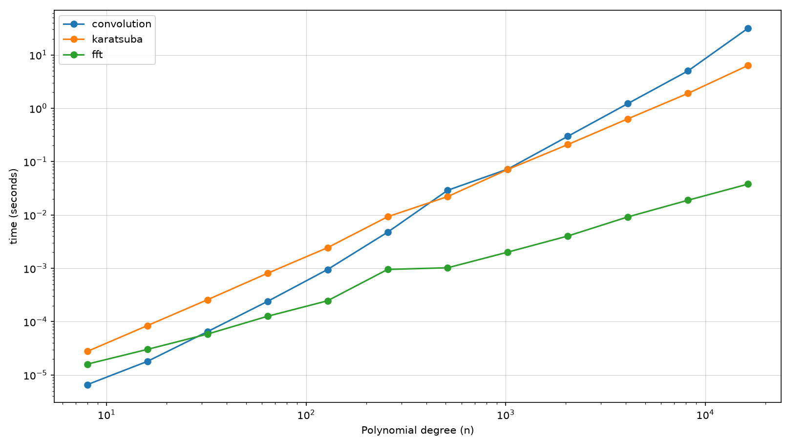

# fast-polynomial

A univariate polynomial library in Python, built around a performance study of
polynomial multiplication across three algorithms, with the asymptotically
fastest implemented in C++ and called from Python via pybind11.

## Multiplication algorithms

The same operation (multiplying two polynomials) is implemented three ways,
each with a different complexity class:

| Algorithm    | Complexity   | Implementation        |
|--------------|--------------|-----------------------|
| Convolution  | O(n²)        | Pure Python           |
| Karatsuba    | O(n^1.585)   | Pure Python, recursive|
| Cooley–Tukey FFT | O(n log n) | C++ via pybind11    |

`__mul__` selects among them automatically by degree, so `p * q` always uses the
fastest method for the operands' size. The thresholds are the empirical crossover
points found by the benchmark below, not arbitrary constants.

## Benchmark

Runtime of each algorithm against polynomial degree, log–log axes, 12 sizes from
8 to 16,384 (minimum of 5 trials per point):



On log–log axes each algorithm appears as a line whose slope is its complexity
exponent, so the plot directly confirms the three complexity classes: convolution
at slope ≈ 2, Karatsuba at ≈ 1.585, FFT at ≈ 1. The measured crossovers are
roughly degree 500 (convolution → Karatsuba) and degree 1000 (Karatsuba → FFT).
At degree 16,384 the C++ FFT runs about three orders of magnitude faster than
pure-Python convolution.

Note: the FFT's lead reflects both a better algorithm and a faster implementation
language (C++ vs Python), so the gap is not purely algorithmic.

## Features

- Immutable `Polynomial` type; coefficients stored as a trimmed tuple where
  `coeffs[i]` is the coefficient of `x**i`
- Full operator overloading: `+`, `-`, `*`, `**`, `divmod`, `//`, `%`, and
  evaluation via `p(x)` (Horner's method)
- Exponentiation by squaring, O(log k) multiplications for `p ** k`
- Euclidean division (quotient and remainder) for polynomial and scalar divisors
- Calculus: `derivative()` and `integral(y_0)` (antiderivative with initial condition)
- `multiply(other, method=...)` to force a specific algorithm, for benchmarking or study
- Tested with pytest (parametrised, edge cases) and type-checked with mypy

## Usage

```py
>>> from algebra_lab import Polynomial
>>> x = Polynomial((0, 1))        # the variable x
>>> p = x**2 + 3*x + 2
>>> print(p)
x^2 + 3x + 2
>>> p(2)
12
>>> q = x + 1
>>> p // q
x + 2
>>> p.derivative()
Polynomial((3, 2))
```

Force a particular multiplication algorithm:

```py
>>> p.multiply(q, method="karatsuba")
```

## Installation

The FFT extension is a C++ module built with pybind11, so it must be compiled:

```bash
pip install -e .
```

This builds the `FFT` extension and installs the package in editable mode. A C++
compiler and pybind11 are required.

## Design choices

- **Immutability.** Every operation returns a new `Polynomial`; instances are never
  mutated. This makes equality and reuse predictable and matches how polynomials
  behave mathematically.
- **Dense representation.** Coefficients are stored as a contiguous tuple, trimmed of
  leading zeros on construction. Simple and fast for the dense polynomials this
  library targets.
- **Three multiplication algorithms.** Rather than one method, the library implements
  the full complexity ladder and chooses between them by measured crossover, which is
  both the performance strategy and the subject of the benchmark.
